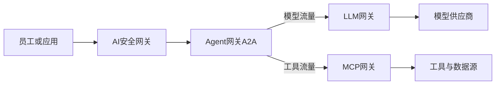
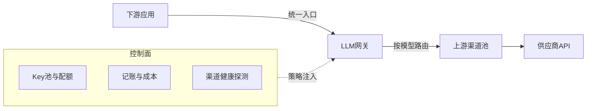

## 引言

　　2025 年 12 月，OpenAI 单月发生 22 起服务事故，累计影响 182.7 小时；同期 Anthropic 20 起、184.5 小时。供应商故障不再是偶发的"坏运气"，而是生产环境必须直面的常态。与此同时，37% 的团队已在生产环境运行 5 个以上模型（一年前这个数字是 29%），单一供应商集成正在从默认架构退化为特例。

　　当 AI 调用成为企业的基础设施流量，一个老问题以新的形态出现了：谁来给这股流量当总闸？Gartner 在 2024 年 API 管理炒作周期中将"AI 网关"列为新兴品类；2026 年 5 月，安全巨头 Palo Alto Networks 收购了 AI 网关公司 Portkey，将其并入 AI 运行时安全平台 Prisma AIRS——一家安全公司花钱买一个"给模型 API 做路由和计量"的产品，这件事本身就说明：AI 网关已经从开发团队的效率工具，变成了企业 AI 流量的控制平面。谁掌握这个入口，谁就决定了 AI 能被谁用、用到什么程度、数据能走多远。

　　本文从定义着手，逐步展开 AI 网关的品类版图，深入 2026 年最前沿的发展与研究，最后聊一聊这个赛道的展望。

## 一、什么是 AI 网关

### 1.1 定义：一个收敛器

　　AI 网关是部署在应用与 AI 能力（模型、工具、Agent）之间的中间层服务：向上提供统一、稳定的接口，向下治理异构、不稳定、持续变化的供应商。它要解决的核心矛盾可以概括成一句话——**把 N 个异构、不稳定、快速演进的 AI 供应商，收敛成 1 个稳定统一的 API。**

　　一个成熟的网关同时承担两类职责，缺一不可：

| 平面 | 职责 | 回答的问题 |
|---|---|---|
| 数据面（每请求必经） | 统一入口与鉴权、智能路由、失败重试与故障转移、语义缓存、内容护栏、协议转换、流式转发 | 这个请求走哪、失败了怎么办 |
| 控制面（决定请求如何流动） | Key 池管理与轮换、配额与限流、用量记账与成本归因、渠道健康探测与熔断、策略配置与审计 | 谁能用、用多少、花了多少钱 |

　　控制面是 AI 网关区别于"一个带重试的 HTTP 封装"的关键，也是它作为"控制平面"的商业价值所在。

### 1.2 能力归属的判断线

　　哪些能力该放进网关、哪些该留在应用？实践中一条好用的判断线是：**是否对每一次请求都成立、且与业务语义无关。**重试、渠道切换、格式转换、限流、记账满足这条线，属于网关；而"哪个业务节点用哪个模型""schema 校验失败后是否回炉重写"带有业务语义，属于应用。

　　推论是：所谓"模型选择"其实有两级，两级各有归宿——"任务 → 模型"的业务级选择留在应用，"模型 → 渠道"的路由级选择交给网关。很多架构争论源于把两级混为一谈。

### 1.3 分层凭据：一个容易被误解的设计

　　AI 网关普遍采用"上游凭据托管 + 下游虚拟令牌"的双层凭据模型：供应商真实 Key 只配置在网关侧（数据库或密钥管理服务），应用拿到的是网关签发的令牌。这与 Stripe 的模式同构——商户平台配置一次银行账户，App 只拿 pk_/sk_ 密钥。它带来的不只是配置收敛，还有安全隔离：应用进程泄露的只是可秒级吊销的网关令牌，供应商真实凭据从头到尾不进应用环境。

## 二、演进三部曲

| 阶段 | 时间 | 核心问题 | 代表 |
|---|---|---|---|
| 中转站时代 | 2023~2024 | 我有多个 Key，想统一调用 | one-api 及大量个人中转站 |
| 工程化时代 | 2024~2025 | 多模型上生产，怎么治理 | LiteLLM、Portkey 崛起 |
| 控制面时代 | 2026 起 | AI 流量成为基础设施，谁来当总闸 | Palo Alto 收购 Portkey 并入 Prisma AIRS |

　　每个时代的"杀手功能"不同：中转站时代拼协议聚合与 Key 管理；工程化时代拼路由、预算与可观测；控制面时代拼治理、安全与合规。一个佐证细节：中转站时代的开山项目 one-api（MIT，35k+ stars）更新已明显放缓，而它的精神续作 new-api（约 50k stars，发版频率 1~2 天/次）仍然活跃——品类在扩张，但重心已经从"中转"移向"运营与治理"。

## 三、类型全景：一个请求穿过的几道闸门

　　2026 年，"AI 网关"已经裂变为五个物种。分类的判断标准不是厂商话术，而是一个朴素的工程问题：**流量在哪一层被管住。**前四类按"做什么"区分，第五类按"怎么交付"区分，彼此互补，大型企业往往跨层组合使用。

　　（概念示意：四类功能品类在流量路径中的位置；私有 AI 网关是横切的交付形态，不在图中。）

### 3.1 LLM 网关（大模型网关）

　　工作在模型 API 层，解决"多模型怎么统一调用、成本怎么管住"。企业引入它的典型触发事件是月底对账：四五家模型平台各有账号、各团队各自持 Key，谁用了多少、花在哪里没人说得清。核心能力包括多模型统一接口、按成本或延迟路由、故障时自动切换、语义缓存、按 token 计量配额、基础内容护栏。

### 3.2 MCP 网关

　　工作在工具与连接器层。MCP（Model Context Protocol）由 Anthropic 于 2024 年 11 月发布，2025 年 12 月捐赠给 Linux 基金会旗下的 Agentic AI Foundation，已成为 Agent 调用外部工具的事实标准。Agent 一旦能调用工具，就能读写数据库、发邮件、改工单——风险从"说错话"升级为"做错事"。

　　MCP 网关把分散的工具服务器聚合成一个受控入口：统一鉴权、代管凭据、按角色过滤可见工具、记录每一次调用。代表产品：Docker MCP Gateway、Microsoft MCP Gateway、IBM ContextForge、agentgateway（Solo.io 捐赠 Linux 基金会）、Amazon Bedrock AgentCore Gateway，以及阿里云/腾讯云 AI 网关的 MCP 能力、Kong 的 MCP 插件。

### 3.3 Agent 网关（A2A）

　　工作在 Agent 编排层，处理 Agent 与 Agent 之间的通信：协议感知路由、Agent 身份认证、有状态的多轮编排、关键动作的人工审批。这一类的标准仍在快速演进，多数企业处于观察和试点阶段，但它是三到五年后"多 Agent 协作"成为主流时最关键的一层。

### 3.4 AI 安全网关（AI 防火墙）

　　工作在内容侧，关注"AI 被怎么用、数据有没有泄漏"：影子 AI（未授权 AI 应用）发现、Prompt 注入与越狱识别、内容级数据防泄漏、输出过滤、审计留痕。它与 LLM 网关的出发点完全不同——**LLM 网关为了"用好"，安全网关为了"管住"**。代表厂商：Palo Alto（Prisma AIRS）、Zscaler、Cloudflare、Cisco、Check Point、Fortinet；国内有奇安信、深信服、天融信等。

### 3.5 网络层私有 AI 网关

　　前四类多以 SaaS 或应用层部署交付，第五类把整套治理能力私有化到企业本地网络，强调数据不出域，满足合规与数据主权诉求。它更多是一个交付形态视角，与前四类正交——任何一类功能都可以选择"私有化交付"。

## 四、LLM 网关深潜：最成熟品类的解剖

### 4.1 三个容易混淆的概念：供应商、模型、渠道

| 层 | 是什么 | 例子 |
|---|---|---|
| 模型供应商 | 谁训练了这个模型 | 智谱、深度求索、Anthropic |
| 模型 | 具体哪个模型 | glm-4.7-flash、claude-sonnet-4 |
| 渠道 | 从哪里调用这个模型 | 官方 API、百炼、火山方舟、硅基流动、OpenRouter |

　　三者是多对多关系：一个模型可以同时存在于多条渠道（官方直连与聚合平台、"直供"与"自部署"），一条渠道也能承载多家供应商的模型。2026 年"模型超市"（百炼、火山方舟、OpenRouter）的兴起，让个人开发者第一次能低成本为主力模型配置真冗余。

　　但渠道冗余生效有一条纪律：**failover 组内的渠道必须确认跑的是同一权重、同一版本**。网关控制台的"渠道测试"按钮只验证连通性，不验证行为等价；确认"同名同模型"要用确定性对拍——固定 seed、贪心解码、探针集逐字比对。否则"无感切换"会变成"悄悄换了个模型"。

### 4.2 数据面与控制面

　　数据面决定"流量怎么走"，控制面决定"流量被允许怎么走"。企业采购时最容易低估的是控制面：多团队共用、虚拟 Key、预算与配额、按团队/组织的成本归因，这些才是网关成为"控制平面"的根基。

### 4.3 代表产品对比（2026-10 查证）

| 产品 | 形态 | 技术栈/协议 | 杀手锏 | 适合场景 |
|---|---|---|---|---|
| LiteLLM | SDK + 自托管代理 | Python（Rust 数据面）/ MIT | 140+ 供应商、虚拟 Key、预算、Guardrails、MCP 网关 | Python 团队、企业治理 |
| new-api | 分发运营平台 | Go / AGPLv3+附加条款 | 计费充值、兑换码、多租户、协议互转、多模态 | 中文环境、对外分发 |
| OpenRouter | 托管聚合 | SaaS | 400+ 模型一键接入、token 原价透传 | 零运维快速起步 |
| Portkey（Prisma AIRS） | 托管 + 混合 | TypeScript / 网关开源 | 20+ 护栏、语义缓存、可观测、企业治理 | 生产团队、安全合规 |
| Higress | 云原生网关 | Go（Envoy 内核）/ Apache-2.0 | AI Wasm 插件：ai-proxy、语义缓存、REST-to-MCP | K8s/阿里云体系 |
| AISIX | 企业 AI 网关 | Rust / Apache-2.0 | 4 vCPU 饱和吞吐约 28,300 req/s、语义路由、模型合议 | 数据面自持、高性能 |
| Kong AI Gateway | 通用网关 + AI 插件 | Go / Apache-2.0 | AI 流量与存量 API 同一控制面 | 已在 Kong 体系 |
| Cloudflare AI Gateway | 边缘代理 | SaaS | 缓存/限流/分析、Auto Router、x402 机器支付实验 | Cloudflare 体系 |

### 4.4 选型的真实决策轴

　　2026 年所有主流网关的 token 加价率已全部归零，功能清单拉不开差距。真正决定选型的是三件事：**部署形态 × failover 默认行为 × 可观测深度**。

　　其中最被低估的是 failover 行为——它各家的默认值并不相同：有的对瞬时错误自动重试，但跨供应商 failover 需要额外配置；有的开箱即用。多数团队是在第一次供应商事故之后才发现自己网关的真实行为，而 failover 是可以也应该在选型时用一个下午对着真实流量测出来的。

## 五、前沿：2026 年正在发生什么

### 5.1 商业：加价归零，竞争轴整体迁移

　　2026 年，Vercel、OpenRouter、Cloudflare、Portkey、LiteLLM 等所有主流网关的 per-token 加价全部归零（按供应商原价透传），商业模型转向平台费、订阅与企业版：

| 网关 | token 加价 | 平台/订阅费 | 自托管 |
|---|---|---|---|
| OpenRouter | 无 | 充值 5.5%（$0.80 起收） | 否 |
| Vercel AI Gateway | 无 | 按量 + 支付费 | 否 |
| Cloudflare AI Gateway | 无 | 直连免费；Unified Billing +5% | 否 |
| Portkey | 无 | $49/月起 + 日志量计费 | 部分 |
| LiteLLM | 无 | 开源免费；企业版约 $250/月起 | 是 |

　　价格战终结后，差异化转移到平台费结构、BYOK（自带 Key）条款与自托管能力。对成本敏感的团队，最优路径已经很清晰：自带 Key 走 0% 平台费，或者干脆自托管开源网关把平台费降到零。

### 5.2 性能：Rust 军备赛与开放基准

　　"网关延迟无关紧要，反正 LLM 本身要几百毫秒"的论调正在被打破——在 Agent 高并发场景下，转发开销是乘数效应。LiteLLM 的 Rust 数据面宣称 p99 新增延迟 0.66ms、常驻内存 22MB、单机 2,800+ req/s（约 21% CPU）；AISIX 在 4 vCPU 下饱和吞吐约 28,300 req/s，转发开销亚毫秒级。

　　更重要的信号是开放基准 **AI Gateway Bench** 的出现：所有网关指向同一个确定性 mock 上游，只测网关自身开销，脚本公开可复跑。对特定上游的 mock 基准历来有"为自家优化"的争议，但基准标准本身的出现，是一个品类工程成熟的标志。

### 5.3 Failover：从功能到生存底线

　　Vercel 的生产索引显示，fallback 挽救了 3.5% 的请求与 5.1% 的 token——以其超万亿 token/月的流量计，这是每月万亿 token 量级"本应报错"的请求。更关键的是流量结构的变化：**Agent 驱动的工作流已贡献超过一半的输出 token**，而 Agent 不会像人一样在供应商宕机时暂停等你修复。自动化容错从"锦上添花"变成"生存底线"，这也解释了为什么 A2A 网关开始进入标准化视野。

### 5.4 MCP 网关：工业与学术同步推进

　　阿里云在 APNet '26 发表的论文《Scaling LLM Agent Tool Access at Cloud Scale》把 MCP 网关的生产级痛点讲得很透：**标准接口不等于生产可用**——遗留服务不是 MCP 可调用的、协议快速演进带来兼容成本、大型工具集撑爆上下文窗口、有状态会话让负载均衡复杂化。解法是集中式 MCP 网关系统：打断直连数据面，聚合遗留 API 集成、协议桥接、访问控制，并以低单次开销做会话感知路由与弹性扩展。

　　学术与工业在同一时间收敛到同一结论，这在中间件领域并不多见——MCP 网关是当前 AI 网关赛道最确定的增量方向。

### 5.5 标准化：基金会与 IETF 接连入场

　　MCP 之外，网关架构本身也进入标准化流程。2026 年 6 月，ZTE 向 IETF 提交了 Agent Gateway 核心功能架构草案（draft-miao-agw-core-functional-architecture-00），把网关能力划分为四类：A2A 网关（Agent 间通信，进一步分解为协议转换、认证安全、异步任务管理、对等网络管理、Agent 路由五个能力）、MCP 网关（工具调用）、模型路由网关（LLM 调用）、网络网关（底层连接）。草案尚在早期（有效期至 2026-12），但"AI 网关"作为通用基础设施组件被写进标准组织的视野，本身就是品类定型的信号。

### 5.6 智能路由：从规则到语义

　　路由策略的演化路径清晰：固定路由 → 规则路由 → 成本/延迟感知 → 语义路由与模型合议（ensemble）。AISIX 已把"多模型并行作答再仲裁"做进产品；Cloudflare 的 Auto Router 按任务与成本自动选模型，User Insights 甚至能指出"哪些请求用了过强的模型、换成便宜的要省多少钱"。

　　但工程纪律同样明确：**没有 trace 不上分类器，没有评测集不上学习型路由。**学习型路由的瓶颈从来不在算法，而在持续运行的质量信号。

### 5.7 边缘与支付实验

　　Cloudflare 在 2026 年 9 月支持了 x402 协议（beta）：客户端用稳定币钱包对 /ai/run 端点的推理请求按次直接支付，无需预充值余额。机器对机器的微支付进入网关，是"Agent 经济"基础设施的雏形。同期上线的 Web Search API（可选 Ceramic.ai / Exa / Linkup 三家搜索供应商）让 Agent 的搜索调用也经过网关记账——网关正在从"管模型"扩展为"管一切 AI 计费单元"。

### 5.8 市场：45.1% 复合增速

　　据 QYR 调研口径（仅统计独立 AI/LLM/Agent-MCP 网关产品与可单独计费模块的直接收入），全球 GenAI 网关平台市场 2025 年销售额约 0.19 亿美元，预计 2032 年达到 2.57 亿美元，2026~2032 年复合增速 45.1%——绝对体量尚小（商业化早期，大量能力仍以开源项目和平台内嵌模块形态存在），但已是企业级 AI 基础设施中增速最猛的细分赛道之一。

## 六、展望

### 6.1 品类融合：Agent Gateway 总闸

　　LLM 网关、MCP 网关、A2A 网关大概率不会长期作为三个并列品类存在——IETF 架构草案已经把它们描绘为一个 Agent Gateway 的四个能力面。融合的驱动因素是真实的：身份体系需要统一（一次认证贯穿模型调用与工具调用）、审计需要统一（"是谁让这个 Agent 做的"必须能回答）、策略需要统一（预算与权限不该按技术层切分）。三到五年内，"AI 网关"这个词的默认含义很可能就是这种融合形态。

### 6.2 独立品类窗口期关闭：下沉或上长

　　作为独立中间层的 LLM 网关，窗口期正在关闭。它要么向下沉进基础设施——Rust 化、边缘化、并入通用 API 网关与云厂商；要么向上长成 AI 控制面——治理模型、工具与 Agent 的总闸。中间地带的产品会被两端挤压：向下的护城河是性能与生态，向上的护城河是治理与安全，纯"转发 + 记账"的中间态最危险。

### 6.3 路由的下一跳：评测闭环

　　智能路由要回答"换便宜模型质量降多少"，前提是有持续运行的评测集与质量信号回流。网关天然是采集这些信号的最好位置——它已经在记录每次调用的完整输入输出。"网关 × 评测"的融合（内置 LLM-as-judge、反馈采集、AB 分流）会是下一个功能竞争高地，也是把"路由智能化"从营销话术变成工程现实的关键一步。

### 6.4 安全与网关互相渗透

　　Palo Alto 收购 Portkey、Cloudflare 同场竞技 AI 防护与 AI 网关、国内安全厂商集体入局——"为了用好"的 LLM 网关与"为了管住"的 AI 安全网关正在互相渗透。对企业的最终形态很可能是同一个入口的两种策略面：默认策略保可用性，安全策略保合规性。谁先在产品里把两种策略面做成一套配置体系，谁就拿到融合红利。

### 6.5 给个人开发者的启示

　　个人项目不必追逐控制面时代的全部能力，但分层判断不变：**业务语义留在应用，供应商丛林外包给网关。**以一个真实配置为例（本站的内容生产 Agent）：应用侧只持有网关签发的令牌与模型链（write 用 GLM、review 用 DeepSeek），供应商真实 Key、渠道冗余、协议适配全部收敛在网关控制台里——添加一家新供应商只需点几下界面，应用一行代码不用改；模型链与备胎的语义留在应用，网关永远不需要懂"write 节点"是什么。这个"自研客户端层 + 开源网关服务端"的两层结构，是个人项目性价比最高的形态。

## 结语

　　AI 网关的故事，本质上是中间件故事的又一次重演：数据库时代有连接池与 ORM，微服务时代有 API 网关与服务网格，AI 时代有了 AI 网关。每一次都是同样的剧本——新能力爆发、接入方式野蛮生长、故障与成本成为常态、中间层收敛。不同的只是演化速度：API 网关走了十年的路，AI 网关正在用三年走完，而且还在加速。

　　对从业者而言，值得记住的不是任何一份产品对比表，而是那条最朴素的判断线：**稳定统一的接口在前，异构多变的供应商在后，中间那层就是网关。**它管流量怎么走，管钱花在哪里，管故障谁先扛——最终，管住 AI 能被谁用、用到什么程度。

## 参考资料

　　以下结论均基于公开资料整理，查证时间为 2026-10-19 或文中标注日期；模型与价格类信息随时间变化较快，落地前请以官方页面实时信息为准。

1. [AI网关是什么？2026五大品类全景 - 腾讯云开发者社区（2026-10-15）](https://developer.cloud.tencent.com/article/2761849)
2. [The 7 Best AI Gateways in 2026 - Vercel（2026-07-27）](https://vercel.com/i/best-ai-gateways)
3. [AI Gateway for Agents, MCPs & LLM Routing - LiteLLM](https://www.litellm.ai/ai-gateway)
4. [6 LLM gateways to consider for production AI in 2026 - Arize AI（价格核验 2026-08-31）](https://arize.com/resources/best-llm-gateways-comparison/)
5. [AI Gateway Fees Compared: Who Marks Up Your Tokens?（2026-06-23）](https://llmgateway.io/blog/ai-gateway-fees-compared)
6. [Scaling LLM Agent Tool Access at Cloud Scale - ACM APNet '26（2026-08-05）](https://dl.acm.org/doi/10.1145/3820441.3821235)
7. [Agent Gateway Core Functional Architecture - IETF Internet-Draft（2026-06-25）](https://www.ietf.org/archive/id/draft-miao-agw-core-functional-architecture-00.html)
8. [Cloudflare AI Gateway Changelog（2026-10-06 更新）](https://developers.cloudflare.com/ai-gateway/changelog/)
9. [GenAI网关平台发展驶入快车道：2026-2032年复合增速45.1% - CSDN（2026-10-10）](https://blog.csdn.net/QYRdata/article/details/163477195)
10. [Best AI Gateways & LLM Routers 2026 - Context Studios（2026-09-24）](https://www.contextstudios.ai/guides/best-ai-gateways-llm-routing-2026)
11. [AI 网关对比：AISIX、Higress、One API、New API、LiteLLM、Portkey - API7](https://www.apiseven.com/ai-gateway-comparison)
